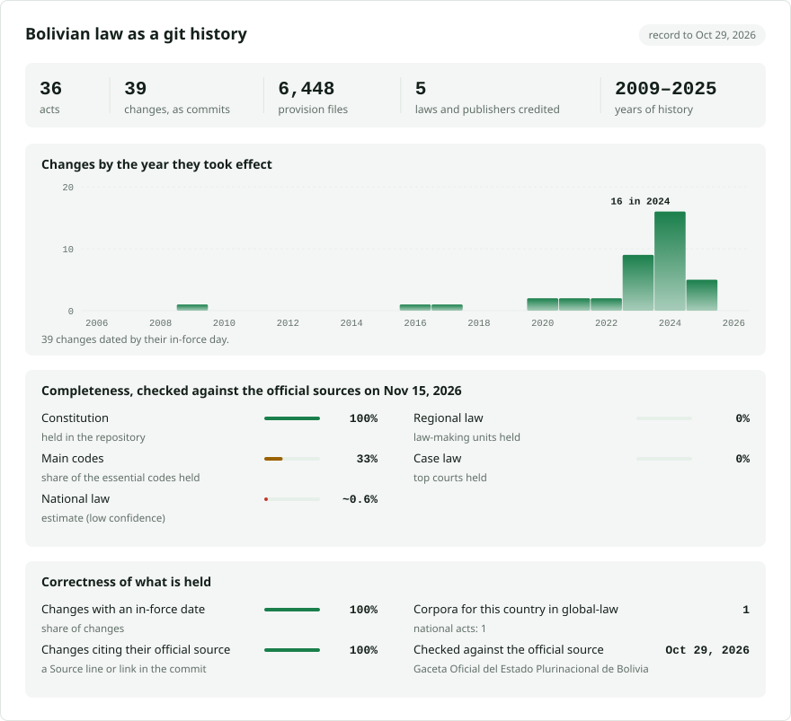

# Bolivia: law history in git

[Español](README.md) · **English**

<picture>
<source media="(prefers-color-scheme: dark)" srcset="data/effort-dark.svg">

</picture>

The national law of Bolivia as a git history: one file per article, one commit per version, and the law, vote or ruling behind each version as the commit's author. `git blame` names the source of every paragraph; `git log` lists every change to an article; picking a date gives the text in force that day, as far as the record reaches.

Part of [lexifina/global-law](https://github.com/lexifina/global-law), one git history for every country's law: this is Bolivia's national law, which global-law reads at `bolivia/national/acts/`.

**What is in it now:** the Constitution of 2009 and 35 national codes and laws, among them the Código Civil, the Código de Comercio, the Estatuto del Funcionario Público and the Ley de Medio Ambiente, with 39 versions. The Constitution's words have never been amended: the 2016 referendum on art. 168 and two rulings of the Tribunal Constitucional Plurinacional (2017, 2023) that left them as they were are commits of their own that change no file (`Words-changed: no`). The 35 codes and laws are one text each, as SILEP consolidated them, because SILEP never shows earlier wording. [`data/versions.json`](data/versions.json) lists every act with its versions; [`data/laws.csv`](data/laws.csv) lists the 66 laws, decrees, votes and rulings the record names.

Each act is a folder named after it (`constitucion/`, `codigo-civil/`, `ley-2027-estatuto-funcionario/`), with one file per article: `constitucion/art-168.md` is art. 168 of the Constitución Política del Estado. Headings are in each folder's `estructura.md`, and its `README.md` lists the provisions.

The text is in Spanish, as the Gaceta Oficial (the Constitution) and SILEP (the codes and laws) print it. An English translation is not part of this record.

## Questions as git commands

| Question | Command |
| --- | --- |
| Every change to art. 168 of the Constitution | `git log -p --word-diff -- constitucion/art-168.md` |
| Which act wrote each line of art. 168? | `git blame constitucion/art-168.md` |
| Every version of the Constitution, with the day each took effect (three changed no words) | `git log --format="%h %(trailers:key=In-force,valueonly,separator=) %an" --grep="^CPE" main` |
| Art. 168 as in force on 1 January 2017 | `python tools/en_vigor_el.py 2017-01-01 constitucion 168` |

**Outside git**, we also host this record publicly, for free:

- **[Ask Claude about Bolivian law](https://global-law.lexifina.com/v1/try_claude?country=bolivia)**: opens Claude with a first question ready.
- **[Ask ChatGPT](https://global-law.lexifina.com/v1/try_chatgpt?country=bolivia)**: the same question in ChatGPT.
- **[Search Bolivian law on our site](https://lexifina.com/law?country=bolivia&q=vacaciones)**: a search for "vacaciones", with each provision's text and its versions, no account needed.
- **[Developer REST API](https://global-law.lexifina.com/v1/search_law?query=vacaciones&jurisdiction=bolivia)**: the same search as JSON, with no key. See the [documentation here](https://lexifina.com/api/global-law).

Both assistants read the record through the free Global law connector (MCP, `https://global-law.lexifina.com/mcp`); the first time, the chat gives you the link that adds it. Ask in Spanish or in English.

**Host it yourself easily.** All it takes is git and Python, and the tools run on your machine:

```sh
git clone --depth 1 https://github.com/lexifina/global-law && cd global-law
python3 tools/countries.py add bolivia/national/acts
python3 tools/law.py show 2026-01-01 bolivia/national/acts/constitucion/art-168.md
```

Opened in Claude Code, Cursor, VS Code or Codex, the clone also starts a local MCP server with the same tools ([MCP.md](https://github.com/lexifina/global-law/blob/main/MCP.md)).

## Dates

Each commit is dated at noon, America/La_Paz, and carries its day in its `In-force:` trailer:

- a law binds from the day it is published in the Gaceta Oficial unless it sets another term (Constitución art. 164.II); the Constitution took effect on its publication, 7 February 2009, as its disposición final provides;
- SILEP does not give the Gaceta day of a text's last change, so each code and law is dated by the earliest archived copy of SILEP's page (or of its PDF) with the same words, the first day the source shows that text, and is not back-dated (the Código Civil is dated 2024-02-24, though in force since 2 April 1976);
- the referendum and the two rulings are dated by the vote (21 February 2016) and the decisions (28 November 2017, 28 December 2023).

The Constitution is credited to its approval and promulgation (`CPE 2009`), and the referendum and each ruling to themselves, at addresses that cannot exist (`scp-0084-2017@gacetaoficialdebolivia.invalid`), so `git blame` and `git log --author` name them. The 35 codes and laws are credited to their publisher, SILEP (Vicepresidencia del Estado), as the "oldest version available", and each commit message names the laws SILEP lists as having changed its provisions, where it lists any; the committer is Lexifina.

## How it is checked

- The Constitution is the Gaceta Oficial's *texto de consulta*, compared unit by unit (412 units) with the official editions of the Tribunal Constitucional Plurinacional (2023) and the Cámara de Diputados (2025): its wording agrees with at least one of them everywhere, and every difference is listed in `REPRODUCE.md`. The preamble, which the Gaceta's text lacks, is the TCP's and must equal the Diputados one.
- The codes and laws are SILEP's text as printed, without its lists of links; the parser checks that every article appears once and in order, and where an archived copy of SILEP's PDF of the same law exists, its words are the same.
- `tools/check_repo.py` reads every version back from git on the day it took effect and on the day before; both must match the corpus: 39 versions of 36 acts, 0 mismatches, and a second build gave identical hashes ([`REPRODUCE.md`](REPRODUCE.md)).
- History is append-only (`tools/append.py`): no merge commits on `main`, no commit dates that go backwards, nothing dated in the future, and every commit's trailers parse.

## What it does not show

- **Earlier wordings.** Each code and law is one text: how the Código Civil read between 1976 and 2010, for example, is not here, only which laws SILEP says last changed which articles.
- **Amendments SILEP did not record.** SILEP stopped applying amendments around 2019-2020, and the newest copy of its Código de Comercio page is from May 2020, so the Code is shown as it stood then.
- **Most national law.** The Gaceta Oficial's index lists 5,617 leyes; 36 acts are here. The Código Penal, the Código de Procedimiento Penal, the Código Procesal Civil, Ley 1178 (SAFCO) and others are left out because SILEP's pages lack later amendments or are incomplete; `REPRODUCE.md` gives each reason.
- **The Constitutions before 2009** (that of 1967 and its reforms), supreme decrees, and rulings other than the two above.

## Sources

| Source | Kind | Past versions | Notes |
| --- | --- | --- | --- |
| [Gaceta Oficial del Estado Plurinacional de Bolivia](https://www.gacetaoficialdebolivia.gob.bo) | Official gazette | no | The Constitution's *texto de consulta*, read through an Internet Archive copy of 6 October 2026 |
| [SILEP](http://www.silep.gob.bo) (Sistema de Información Legal del Estado Plurinacional, Vicepresidencia del Estado) | Official legal information system | no: the current text, with the last law that changed each provision | The Código Civil, the Código de Comercio and 33 laws, read from Internet Archive copies of its pages; its footer leaves the legal reference to the Gaceta |
| [Tribunal Constitucional Plurinacional](https://tcpbolivia.bo) | Official edition of the Constitution | no | 2023 edition: the preamble and the cross-check |
| [Cámara de Diputados](https://diputados.gob.bo) | Official edition of the Constitution | no | 2025 edition: the cross-check |
| [Procuraduría General del Estado](https://www.procuraduria.gob.bo) | State's counsel | n/a | Hosts SCP 1010/2023-S4 and CIDH Informe 121/24, the sources for the referendum and the two rulings |

## Licence

See [`LICENSE`](LICENSE). The legal texts are official texts of the Estado Plurinacional de Bolivia, reproduced with attribution to their sources; the Gaceta marks its text "TEXTO DE CONSULTA" and "Derechos Reservados © Gaceta Oficial de Bolivia", no source publishes a licence, and their copyright status is not confirmed. Lexifina's own contributions (the arrangement, commit messages, tables and tools) are CC0 1.0.

No AI model wrote, translated or corrected legal text, and none runs at build time; the scripts were written by Claude Code running Claude Opus 5.5 (see [`REPRODUCE.md`](REPRODUCE.md)).

## More

From [lexifina/global-law](https://github.com/lexifina/global-law):

- [FEATURES.md](https://github.com/lexifina/global-law/blob/main/FEATURES.md): every feature, and what every corpus must support (`git blame`, `law.py`, the MCP tools)
- [FAQ.md](https://github.com/lexifina/global-law/blob/main/FAQ.md): questions and answers · [CONTRIBUTING.md](https://github.com/lexifina/global-law/blob/main/CONTRIBUTING.md): proposing changes · [MCP.md](https://github.com/lexifina/global-law/blob/main/MCP.md): the MCP server · [REPRODUCE.md](https://github.com/lexifina/global-law/blob/main/REPRODUCE.md): how it was built · [CHANGELOG.md](https://github.com/lexifina/global-law/blob/main/CHANGELOG.md)
- [FRESHNESS.md](https://github.com/lexifina/global-law/blob/main/FRESHNESS.md): how current each corpus is · [Monitoring](https://github.com/lexifina/global-law/tree/main/monitoring): whether updates are running · [WATCHING.md](https://github.com/lexifina/global-law/blob/main/WATCHING.md): how each official source is watched for changes
- [performance/](https://github.com/lexifina/global-law/tree/main/performance): how fast the tools are, measured
- [visualisations/](https://github.com/lexifina/global-law/tree/main/visualisations): charts and bridges across the world's law
- [Vulnerabilities](https://github.com/lexifina/global-law/tree/main/vulnerabilities): mistakes in legislation as published
