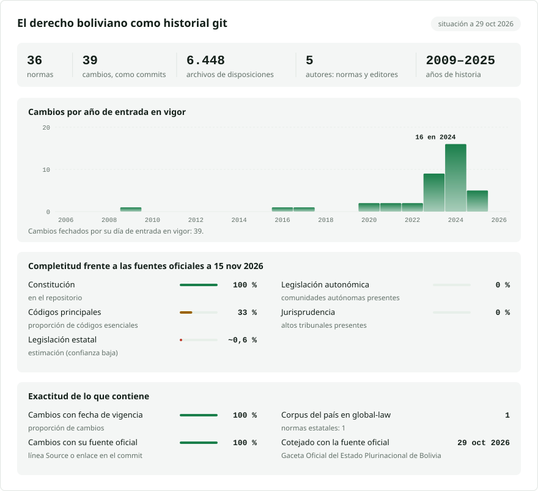

# Bolivia: historia del derecho en git

**Español** · [English](README.en.md)

<picture>
<source media="(prefers-color-scheme: dark)" srcset="data/es/effort-dark.svg">

</picture>

El derecho nacional de Bolivia como historia de git: un archivo por artículo, un commit por versión, y la ley, la votación o la sentencia que dio origen a cada versión como autor del commit. `git blame` indica el origen de cada párrafo; `git log` enumera todos los cambios de un artículo; al elegir una fecha se obtiene el texto vigente ese día, hasta donde alcanza el registro.

Forma parte de [lexifina/global-law](https://github.com/lexifina/global-law), una única historia de git para el derecho de todos los países: este es el derecho nacional de Bolivia, que global-law lee en `bolivia/national/acts/`.

**Qué contiene ahora:** la Constitución de 2009 y 35 códigos y leyes nacionales, entre ellos el Código Civil, el Código de Comercio, el Estatuto del Funcionario Público y la Ley de Medio Ambiente, con 39 versiones. El texto de la Constitución nunca ha sido modificado: el referendo de 2016 sobre el art. 168 y dos sentencias del Tribunal Constitucional Plurinacional (2017, 2023) que lo dejaron como estaba son commits propios que no cambian ningún archivo (`Words-changed: no`). Los 35 códigos y leyes son un único texto cada uno, tal como el SILEP los actualizó, porque el SILEP nunca muestra redacciones anteriores. [`data/versions.json`](data/versions.json) enumera cada norma con sus versiones; [`data/laws.csv`](data/laws.csv) enumera las 66 leyes, decretos, votaciones y sentencias que el registro menciona.

Cada norma es una carpeta con su nombre (`constitucion/`, `codigo-civil/`, `ley-2027-estatuto-funcionario/`), con un archivo por artículo: `constitucion/art-168.md` es el art. 168 de la Constitución Política del Estado. Los encabezados están en el `estructura.md` de cada carpeta, y su `README.md` enumera las disposiciones.

El texto está en español, tal como lo publican la Gaceta Oficial (la Constitución) y el SILEP (los códigos y leyes). Este registro no incluye una traducción al inglés.

## Preguntas como comandos de git

| Pregunta | Comando |
| --- | --- |
| Todos los cambios del art. 168 de la Constitución | `git log -p --word-diff -- constitucion/art-168.md` |
| ¿Qué norma escribió cada línea del art. 168? | `git blame constitucion/art-168.md` |
| Todas las versiones de la Constitución, con el día en que entró en vigor cada una (tres no cambiaron ninguna palabra) | `git log --format="%h %(trailers:key=In-force,valueonly,separator=) %an" --grep="^CPE" main` |
| El art. 168 vigente al 1 de enero de 2017 | `python tools/en_vigor_el.py 2017-01-01 constitucion 168` |

**Fuera de git**, también alojamos este registro de forma pública y gratuita:

- **[Preguntar a Claude sobre el derecho boliviano](https://global-law.lexifina.com/v1/try_claude?country=bolivia)**: abre Claude con una primera pregunta preparada.
- **[Preguntar a ChatGPT](https://global-law.lexifina.com/v1/try_chatgpt?country=bolivia)**: la misma pregunta en ChatGPT.
- **[Buscar en el derecho boliviano en nuestro sitio](https://lexifina.com/law?country=bolivia&q=vacaciones)**: una búsqueda de "vacaciones", con el texto de cada disposición y sus versiones, sin necesidad de cuenta.
- **[API REST para desarrolladores](https://global-law.lexifina.com/v1/search_law?query=vacaciones&jurisdiction=bolivia)**: la misma búsqueda en JSON, sin clave. Consulte la [documentación aquí](https://lexifina.com/api/global-law).

Ambos asistentes leen el registro a través del conector gratuito Global law (MCP, `https://global-law.lexifina.com/mcp`); la primera vez, el chat le da el enlace para agregarlo. Pregunte en español o en inglés.

**Alójelo usted mismo fácilmente.** Solo hacen falta git y Python, y las herramientas se ejecutan en su equipo:

```sh
git clone --depth 1 https://github.com/lexifina/global-law && cd global-law
python3 tools/countries.py add bolivia/national/acts
python3 tools/law.py show 2026-01-01 bolivia/national/acts/constitucion/art-168.md
```

Abierto en Claude Code, Cursor, VS Code o Codex, el clon también inicia un servidor MCP local con las mismas herramientas ([MCP.md](https://github.com/lexifina/global-law/blob/main/MCP.md)).

## Fechas

Cada commit está fechado a las doce del mediodía, hora de America/La_Paz, y lleva su día en su trailer `In-force:`:

- una ley es de cumplimiento obligatorio desde el día de su publicación en la Gaceta Oficial, salvo que establezca otro plazo (art. 164.II de la Constitución); la Constitución entró en vigor con su publicación, el 7 de febrero de 2009, como dispone su disposición final;
- el SILEP no indica el día de la Gaceta en que se publicó el último cambio de un texto, por lo que cada código y ley se fecha por la copia archivada más antigua de la página del SILEP (o de su PDF) con las mismas palabras, el primer día en que la fuente muestra ese texto, y no se le asigna una fecha retroactiva (el Código Civil está fechado el 2024-02-24, aunque está vigente desde el 2 de abril de 1976);
- el referendo y las dos sentencias se fechan por la votación (21 de febrero de 2016) y por las decisiones (28 de noviembre de 2017, 28 de diciembre de 2023).

La Constitución se atribuye a su aprobación y promulgación (`CPE 2009`), y el referendo y cada sentencia a sí mismos, con direcciones que no pueden existir (`scp-0084-2017@gacetaoficialdebolivia.invalid`), de modo que `git blame` y `git log --author` los indican. Los 35 códigos y leyes se atribuyen a quien los publica, el SILEP (Vicepresidencia del Estado), como "versión más antigua disponible", y el mensaje de cada commit indica las leyes que, según el SILEP, modificaron sus disposiciones, cuando el SILEP enumera alguna; el committer es Lexifina.

## Cómo se verifica

- La Constitución es el *texto de consulta* de la Gaceta Oficial, cotejado unidad por unidad (412 unidades) con las ediciones oficiales del Tribunal Constitucional Plurinacional (2023) y de la Cámara de Diputados (2025): su redacción coincide en todo con al menos una de ellas, y cada diferencia se enumera en `REPRODUCE.md`. El preámbulo, que falta en el texto de la Gaceta, es el del TCP y debe ser idéntico al de Diputados.
- Los códigos y leyes son el texto del SILEP tal como se publica, sin sus listas de enlaces; el analizador verifica que cada artículo aparezca una sola vez y en orden, y, donde existe una copia archivada del PDF del SILEP de la misma ley, sus palabras son las mismas.
- `tools/check_repo.py` vuelve a leer desde git cada versión el día en que entró en vigor y el día anterior; ambas lecturas deben coincidir con el corpus: 39 versiones de 36 normas, 0 discrepancias, y una segunda compilación dio hashes idénticos ([`REPRODUCE.md`](REPRODUCE.md)).
- La historia solo admite agregados (`tools/append.py`): no hay commits de fusión (merge) en `main`, ni fechas de commit que retrocedan, ni nada fechado en el futuro, y los trailers de todos los commits se analizan sin errores.

## Qué no muestra

- **Las redacciones anteriores.** Cada código y ley es un único texto: por ejemplo, no está aquí cómo se leía el Código Civil entre 1976 y 2010, sino solo qué leyes, según el SILEP, modificaron por última vez qué artículos.
- **Las modificaciones que el SILEP no registró.** El SILEP dejó de incorporar modificaciones hacia 2019-2020, y la copia más reciente de su página del Código de Comercio es de mayo de 2020, por lo que el Código se muestra tal como estaba entonces.
- **La mayor parte del derecho nacional.** El índice de la Gaceta Oficial enumera 5.617 leyes; aquí hay 36 normas. El Código Penal, el Código de Procedimiento Penal, el Código Procesal Civil, la Ley 1178 (SAFCO) y otras quedan fuera porque las páginas del SILEP no incluyen modificaciones posteriores o están incompletas; `REPRODUCE.md` indica el motivo de cada una.
- **Las Constituciones anteriores a 2009** (la de 1967 y sus reformas), los decretos supremos y las sentencias distintas de las dos mencionadas.

## Fuentes

| Fuente | Tipo | Versiones anteriores | Notas |
| --- | --- | --- | --- |
| [Gaceta Oficial del Estado Plurinacional de Bolivia](https://www.gacetaoficialdebolivia.gob.bo) | Gaceta oficial | no | El *texto de consulta* de la Constitución, leído a través de una copia de Internet Archive del 6 de octubre de 2026 |
| [SILEP](http://www.silep.gob.bo) (Sistema de Información Legal del Estado Plurinacional, Vicepresidencia del Estado) | Sistema oficial de información legal | no: el texto vigente, con la última ley que modificó cada disposición | El Código Civil, el Código de Comercio y 33 leyes, leídos de copias de sus páginas en Internet Archive; su pie de página remite a la Gaceta como referencia legal |
| [Tribunal Constitucional Plurinacional](https://tcpbolivia.bo) | Edición oficial de la Constitución | no | Edición de 2023: el preámbulo y el cotejo |
| [Cámara de Diputados](https://diputados.gob.bo) | Edición oficial de la Constitución | no | Edición de 2025: el cotejo |
| [Procuraduría General del Estado](https://www.procuraduria.gob.bo) | Abogacía del Estado | no corresponde | Aloja la SCP 1010/2023-S4 y el Informe 121/24 de la CIDH, las fuentes del referendo y de las dos sentencias |

## Licencia

Véase [`LICENSE`](LICENSE). Los textos normativos son textos oficiales del Estado Plurinacional de Bolivia, reproducidos con atribución a sus fuentes; la Gaceta marca su texto como "TEXTO DE CONSULTA" y "Derechos Reservados © Gaceta Oficial de Bolivia", ninguna fuente publica una licencia y la situación de los textos en materia de derecho de autor no está confirmada. Las contribuciones propias de Lexifina (la organización, los mensajes de commit, las tablas y las herramientas) son CC0 1.0.

Ningún modelo de IA escribió, tradujo ni corrigió texto normativo, y ninguno se ejecuta durante la compilación; los scripts los escribió Claude Code con Claude Opus 5.5 (véase [`REPRODUCE.md`](REPRODUCE.md)).

Esta es una traducción de la versión inglesa ([README.en.md](README.en.md)); si difieren, prevalece la versión inglesa.

## Más información

Del repositorio [lexifina/global-law](https://github.com/lexifina/global-law) (páginas en inglés):

- [FEATURES.md](https://github.com/lexifina/global-law/blob/main/FEATURES.md): todas las funciones y lo que cada corpus debe admitir (`git blame`, `law.py`, herramientas MCP)
- [FAQ.md](https://github.com/lexifina/global-law/blob/main/FAQ.md): preguntas y respuestas · [CONTRIBUTING.md](https://github.com/lexifina/global-law/blob/main/CONTRIBUTING.md): proponer cambios · [MCP.md](https://github.com/lexifina/global-law/blob/main/MCP.md): servidor MCP · [REPRODUCE.md](https://github.com/lexifina/global-law/blob/main/REPRODUCE.md): cómo se ha construido · [CHANGELOG.md](https://github.com/lexifina/global-law/blob/main/CHANGELOG.md)
- [FRESHNESS.md](https://github.com/lexifina/global-law/blob/main/FRESHNESS.md): lo actualizado que está cada corpus · [Supervisión](https://github.com/lexifina/global-law/tree/main/monitoring): si las actualizaciones funcionan · [WATCHING.md](https://github.com/lexifina/global-law/blob/main/WATCHING.md): cómo se vigila cada fuente oficial para detectar cambios
- [performance/](https://github.com/lexifina/global-law/tree/main/performance): la rapidez de las herramientas, medida
- [visualisations/](https://github.com/lexifina/global-law/tree/main/visualisations): gráficos y conexiones a través del derecho de todo el mundo
- [Vulnerabilidades](https://github.com/lexifina/global-law/tree/main/vulnerabilities): errores en las normas tal como se publicaron
